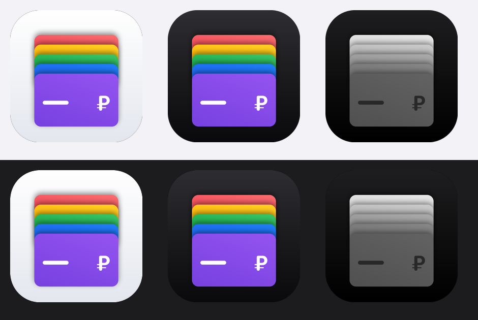
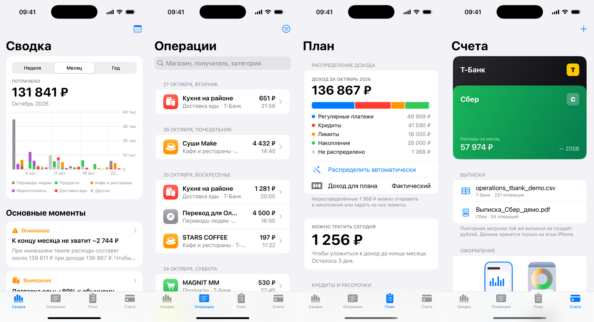
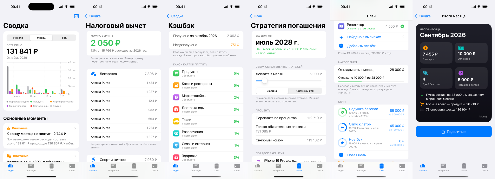
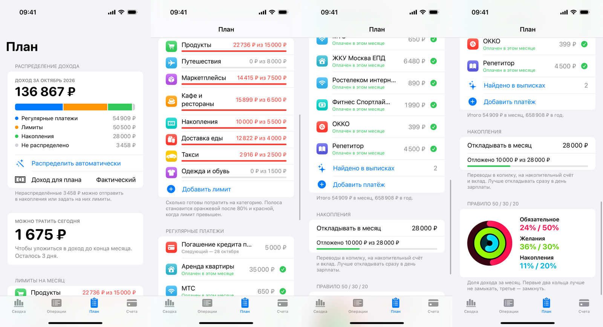
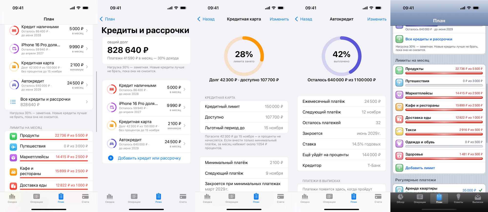
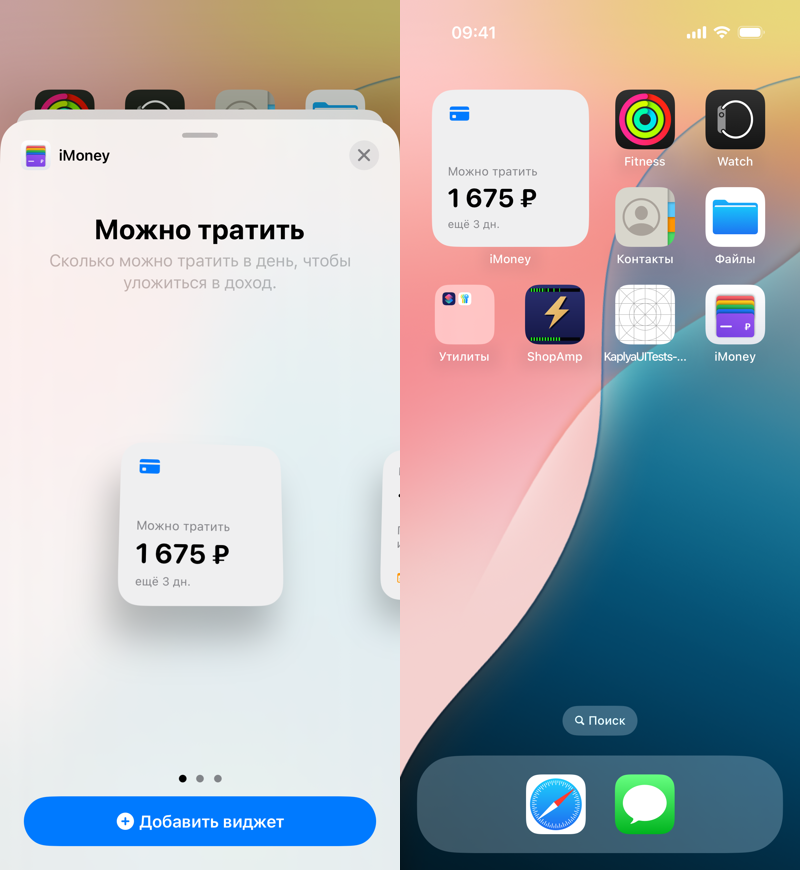
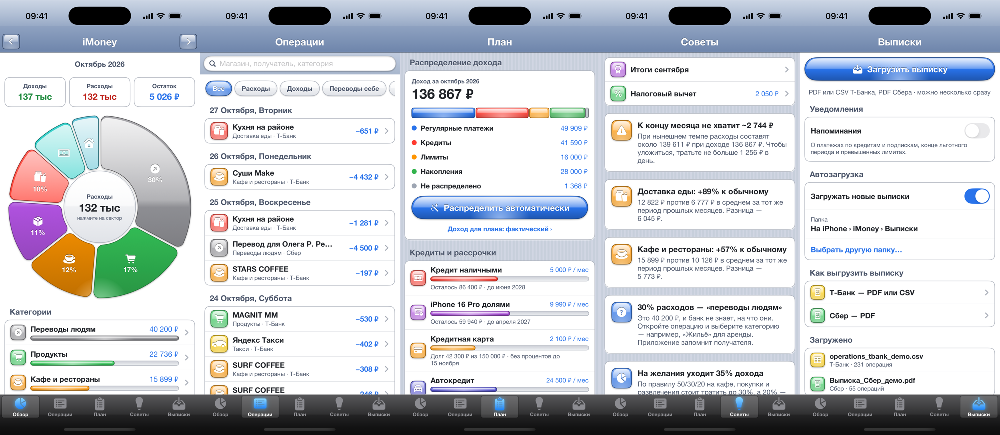
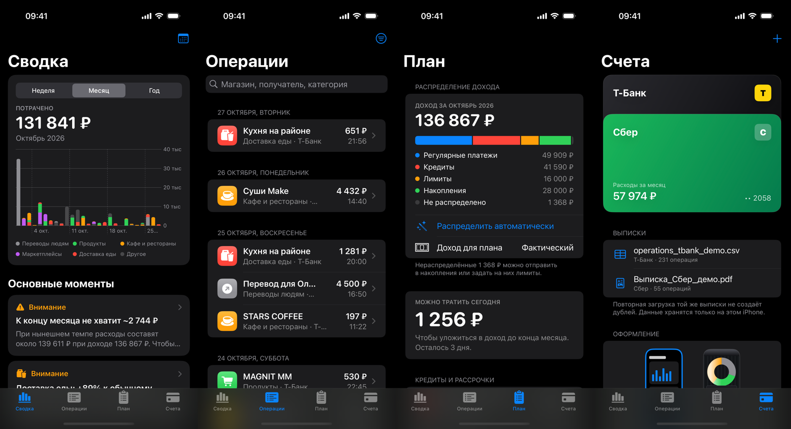
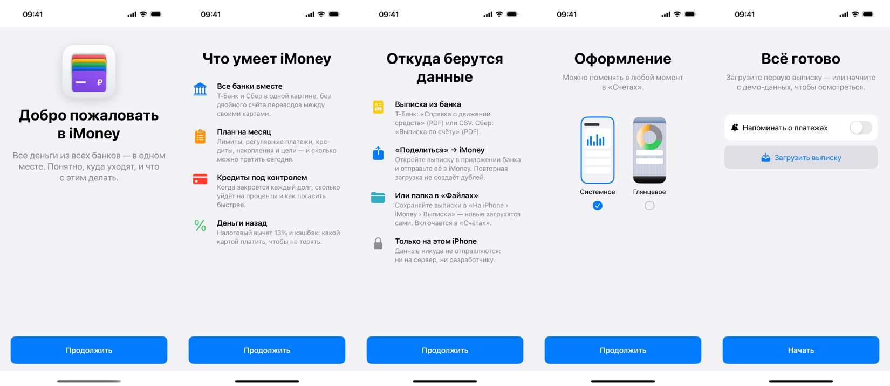
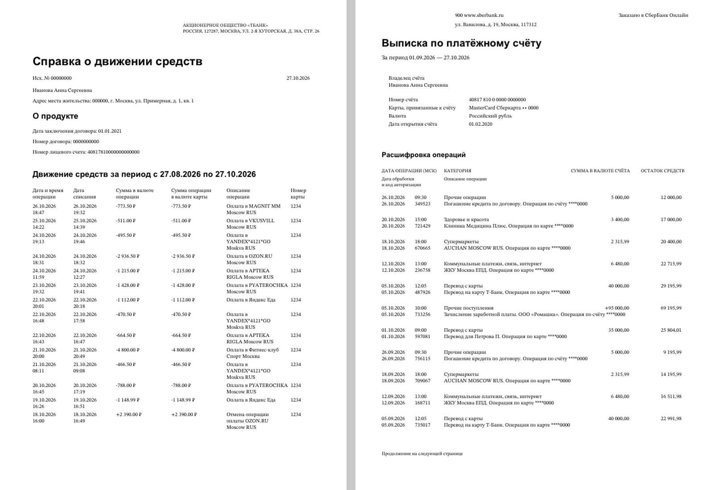

# iMoney — учёт личных расходов для iPhone



iMoney собирает выписки Т-Банка и Сбера в одну картину: убирает переводы между своими счетами,
расшифровывает «переводы людям», строит план на месяц, следит за кредитами и подсказывает, где вернуть деньги.
Все данные хранятся только на iPhone — ни сервера, ни аккаунта.



## Возможности

- **Сводка** — траты по дням с разбивкой на категории, основные моменты, категории, азбука финансов.
- **Операции** — список по дням, поиск, фильтры, смена категории свайпом, запоминание получателей.
- **План** — распределение дохода между регулярными платежами, кредитами, лимитами и накоплениями; автоплан по правилу 50/30/20; «можно тратить сегодня».
- **Кредиты и рассрочки** — кредиты, ипотека, автокредит, рассрочки, кредитные карты, долги людям: сколько выплачено, когда закроется, переплата по процентам, долговая нагрузка.
- **Кредитные карты** — по последним 4 цифрам карты или номеру договора находит её операции в выписках: покупки остаются тратами, пополнения кредитки с других счетов становятся погашением долга, а не «переводом между счетами». Подсказка «Можно ли пользоваться картой», безопасная сумма и проверка покупки.
- **Стратегия погашения** — «лавина» или «снежный ком»: дата без долгов и экономия на процентах при доплате.
- **Цели накоплений** — кольца прогресса и сколько откладывать в месяц к сроку.
- **Налоговый вычет 13%** — находит в выписках лечение, лекарства, обучение, спорт и проценты по ипотеке, считает возврат с учётом лимитов.
- **Кэшбэк и проценты** — сколько банки вернули за месяц и год: кэшбэк, бонусы и проценты на остаток по поступлениям из выписок.
- **Итоги месяца** — карточка в духе наград Фитнеса, которой можно поделиться.
- **Напоминания** — о платежах по кредитам и подпискам, конце льготного периода, превышении лимитов.
- **Виджеты и Siri** — «Можно тратить сегодня» и кольца бюджета на домашнем экране и экране блокировки; голосовые команды.
- **Обучение при первом запуске** — пять экранов в стиле приветствия Apple.
- **Два оформления** — системное (по правилам Apple) и глянцевое в духе iOS 6; оба сами переключаются между светлой и тёмной темой.









## Какие выписки подходят

| Банк | Документ | Формат |
|---|---|---|
| Т-Банк | Справка о движении средств (из приложения) | PDF |
| Т-Банк | Выгрузка операций (веб-версия) | CSV |
| Сбер | Выписка по платёжному счёту (СберБанк Онлайн) | PDF |

Выписку можно загрузить кнопкой «+», через «Поделиться → iMoney» из приложения банка
или положить в папку «На iPhone › iMoney › Выписки» — включённая автозагрузка подхватит новый файл при открытии приложения.
Повторная загрузка той же выписки не создаёт дублей.

### Примеры для проверки

В папке [`examples`](examples) — выписки **с вымышленными данными**, повторяющие макет настоящих документов банков:

- `Пример — справка Т-Банка.pdf` — 121 операция;
- `Пример — выписка Сбера.pdf` — 13 операций;
- `Пример — операции Т-Банка.csv` — 40 операций.



Их можно отправить на iPhone и загрузить в iMoney. Если загрузить обе PDF, перевод 40 000 ₽ со Сбера на Т-Банк
распознается как перевод между своими счетами. Примеры генерирует скрипт `examples/make_examples.py`.

## Сборка

Нужен Xcode 16.2 или новее, iOS 17+.

```bash
xcodebuild -project Kaplya.xcodeproj -scheme Kaplya -sdk iphonesimulator -derivedDataPath build build
```

Тесты интерфейса (17 сценариев):

```bash
xcodebuild test -project Kaplya.xcodeproj -scheme Kaplya -destination 'platform=iOS Simulator,name=iPhone 16 Pro'
```

Для установки на iPhone и публикации в App Store укажите свою команду разработчика (Signing & Capabilities)
и зарегистрируйте группу приложений `group.com.geronimo.kaplya` — она нужна виджету.

Флаги запуска для разработки: `-demo` (демо-данные без сохранения), `-tab=…`, `-design=system|aqua`,
`-light` / `-dark`, `-onboarding`, `-import=/путь/к/файлу`.

## Устройство проекта

- `Kaplya/Import` — разбор выписок (PDF по видимым строкам таблицы, CSV), категоризация, автозагрузка.
- `Kaplya/Model` — данные и расчёты: план, кредиты, цели, кэшбэк, налоговый вычет, напоминания, Siri.
- `Kaplya/Analytics` — статистика, прогноз, подсказки.
- `Kaplya/UI` — системное оформление; `Kaplya/UI/Aqua` — глянцевое.
- `KaplyaWidget`, `Shared` — виджеты и общие с ними данные.
- `KaplyaUITests` — тесты интерфейса.

Иконка рисуется скриптом `docs/icon_wallets.py` (`python3 docs/icon_wallets.py <папка> final`).

## Конфиденциальность

Приложение не собирает и не отправляет никаких данных: выписки разбираются на устройстве,
результаты хранятся в его песочнице. Манифест конфиденциальности — `Kaplya/PrivacyInfo.xcprivacy`.
